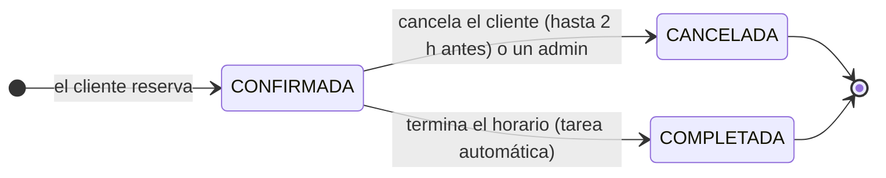
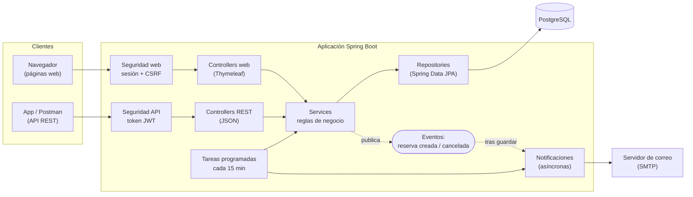
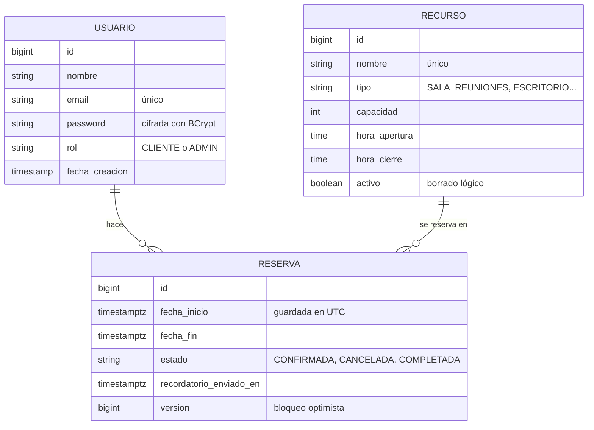
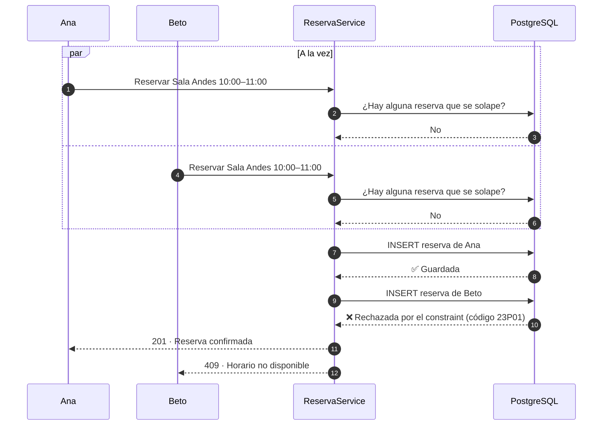
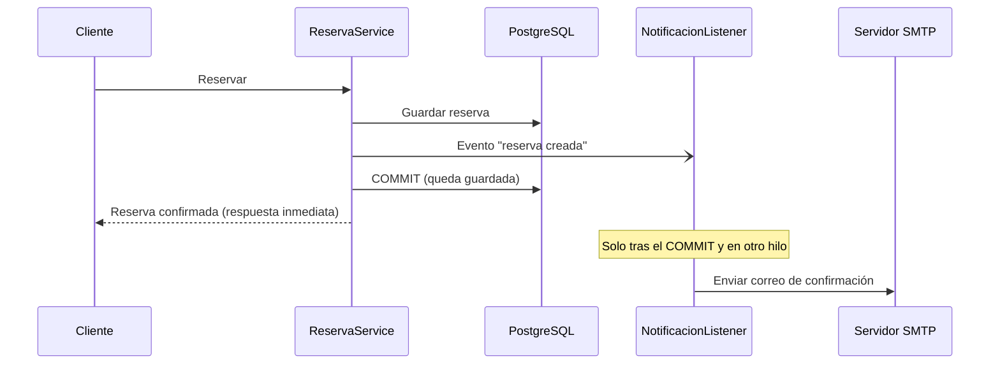

# Sistema de Reservas — Coworking y Salas de Reuniones

[](https://github.com/RamCupido/sistema-reservas-coworking/actions/workflows/ci.yml)


## En pocas palabras

Imagina un edificio de coworking con salas de reuniones, escritorios, oficinas privadas y un auditorio.
Este proyecto es la **aplicación web para reservarlos**:

- Cualquiera puede ver los espacios y **qué horarios están libres** cada día.
- Quien tiene cuenta **reserva** un horario, recibe un **correo de confirmación** y, 24 horas antes, un
  **recordatorio**. Si no puede ir, **cancela** desde la web.
- La administración **gestiona los espacios** (crear, editar, desactivar) y **ve todas las reservas**.

Lo más importante que resuelve: **nunca dos personas pueden reservar el mismo espacio a la misma hora**,
ni siquiera si pulsan "Reservar" exactamente en el mismo instante.

Además de la web, ofrece una **API REST** documentada, lista para conectar una app móvil o un frontend en React.

> Proyecto de portafolio construido por fases, con tests automáticos y verificación continua en GitHub Actions.

---

## Contenido

1. [¿Qué se puede hacer?](#qué-se-puede-hacer)
2. [Cómo se vive una reserva](#cómo-se-vive-una-reserva)
3. [Cómo está construido](#cómo-está-construido)
4. [Tecnologías](#tecnologías)
5. [Datos que guarda](#datos-que-guarda)
6. [Reglas del negocio](#reglas-del-negocio)
7. [El reto: dos reservas en el mismo instante](#el-reto-dos-reservas-en-el-mismo-instante)
8. [Correos y tareas automáticas](#correos-y-tareas-automáticas)
9. [Seguridad](#seguridad)
10. [Ejecutarlo en tu ordenador](#ejecutarlo-en-tu-ordenador)
11. [API REST](#api-rest)
12. [Configuración](#configuración)
13. [Calidad: tests y CI](#calidad-tests-y-ci)
14. [Estructura del código](#estructura-del-código)
15. [Decisiones técnicas](#decisiones-técnicas)
16. [Glosario](#glosario)
17. [Roadmap](#roadmap)

---

## ¿Qué se puede hacer?

| Quién | Qué puede hacer |
|-------|-----------------|
| **Visitante** (sin cuenta) | Ver el catálogo de espacios, filtrar por tipo y consultar la agenda de cualquier día |
| **Cliente** (con cuenta) | Todo lo anterior + reservar, ver "Mis reservas" y cancelar las suyas hasta 2 horas antes |
| **Administrador** | Todo lo anterior + crear, editar, desactivar y reactivar espacios; ver y cancelar cualquier reserva |

Tipos de espacio: **sala de reuniones**, **escritorio**, **oficina privada** y **auditorio**.
Cada uno tiene capacidad y horario de atención (por ejemplo, de 08:00 a 20:00).

## Cómo se vive una reserva

1. **Elegir un espacio** en el catálogo y abrir su **agenda**: el día aparece dividido en bloques de 30 minutos,
   en verde los libres y tachados los ocupados o ya pasados.
2. **Seleccionar el horario** pulsando el bloque de inicio y el de fin.
3. **Confirmar.** El servidor vuelve a comprobarlo todo: horario de atención, que siga libre y que no sea en el
   pasado.
4. **Llega un correo** de confirmación con los detalles.
5. **24 horas antes** llega un recordatorio.
6. Si hace falta, se **cancela** desde "Mis reservas" (hasta 2 horas antes) y llega un correo de cancelación.
7. Cuando el horario termina, la reserva pasa sola al estado **completada**.



> No hay precios ni pagos: reservar es gratuito y las reservas nacen confirmadas.

## Cómo está construido

La aplicación sigue una **arquitectura por capas**. Una analogía útil es un restaurante:

| Capa | En el restaurante | En el proyecto |
|------|-------------------|----------------|
| **Controllers** | El camarero: toma el pedido y entrega el plato, pero no cocina | Reciben la petición (página web o API), validan el formato y devuelven la respuesta |
| **Services** | La cocina: donde se aplican las recetas | Toda la lógica de negocio: solapamientos, horarios, plazos |
| **Repositories** | La despensa | Leen y guardan datos en PostgreSQL |

La web y la API son **dos puertas de entrada a la misma cocina**: ambas usan los mismos services, así que
las reglas de negocio están escritas una sola vez.



## Tecnologías

| Tecnología | Para qué se usa aquí |
|------------|----------------------|
| **Java 21** + **Spring Boot 3.5** | Lenguaje y framework base de toda la aplicación |
| **Spring Web** | Atender las peticiones HTTP (páginas y API) |
| **Spring Data JPA** + Hibernate | Convertir objetos Java en filas de la base de datos y al revés |
| **PostgreSQL 17** | Base de datos; además garantiza que no haya reservas solapadas |
| **Flyway** | Versionar los cambios de la base de datos (`V1__...sql`, `V2__...sql`...) |
| **Spring Security** + **JWT** | Login, roles (cliente/admin) y protección de cada ruta |
| **Bean Validation** | Validar datos de entrada ("el email es obligatorio", "capacidad > 0"...) |
| **Thymeleaf** + **Bootstrap 5** | Generar las páginas HTML en el servidor con un diseño responsive |
| **Spring Mail** + `@Async` + `@Scheduled` | Enviar correos en segundo plano y ejecutar tareas periódicas |
| **springdoc-openapi** | Documentación interactiva de la API (Swagger UI) |
| **JUnit 5**, **Mockito**, **MockMvc**, **Testcontainers** | Tests automáticos, incluidos tests contra un PostgreSQL real |
| **Docker Compose** | Levantar PostgreSQL y Mailpit en local con un comando |
| **GitHub Actions** | Ejecutar todos los tests en cada push y pull request |

## Datos que guarda



- Las contraseñas nunca se guardan tal cual: se guarda un *hash* BCrypt, imposible de revertir.
- Un espacio "eliminado" en realidad se **desactiva**: las reservas antiguas siguen apuntando a él.
- Las fechas se guardan en **UTC** y se muestran en la **hora local del coworking** (`America/Guayaquil`, configurable).

## Reglas del negocio

| # | Regla | Cómo se garantiza |
|---|-------|-------------------|
| 1 | **No hay dos reservas solapadas** en el mismo espacio (las canceladas no cuentan). 10:00–11:00 y 11:00–12:00 sí pueden convivir | Comprobación en el service **y** constraint en PostgreSQL ([ver abajo](#el-reto-dos-reservas-en-el-mismo-instante)) |
| 2 | **Dos personas no pueden ganar el mismo horario** aunque reserven a la vez | Constraint `EXCLUDE USING gist` en la base de datos |
| 3 | Dentro del **horario de atención**, en **bloques de 30 minutos**, el mismo día y **nunca en el pasado** | Validación en `ReservaService` |
| 4 | El cliente **solo cancela las suyas y hasta 2 horas antes**; el admin, cualquiera | `ReservaService`. Una reserva ajena responde "no encontrada", sin confirmar que existe |
| 5 | **Recordatorio por correo 24 h antes** | Tarea programada cada 15 minutos |

Si un administrador desactiva un espacio, sus reservas futuras **se mantienen** y el panel le avisa de
cuántas hay, para que decida qué hacer con ellas.

## El reto: dos reservas en el mismo instante

**El problema.** Ana y Beto quieren la Sala Andes de 10:00 a 11:00 y pulsan "Reservar" a la vez. Si el sistema
solo hiciera "¿está libre? → sí → guardar", las dos peticiones podrían preguntar *antes* de que ninguna haya
guardado. Las dos verían "libre" y habría **dos reservas para la misma sala**.

**La solución: dos capas de protección.**

1. **Comprobación previa** en el service: resuelve el caso normal con un mensaje claro ("ya tiene una reserva
   que se solapa").
2. **Una regla dentro de la propia base de datos**, que PostgreSQL aplica de forma atómica. Aunque las dos
   peticiones pasen la comprobación, solo una consigue guardar:

```sql
CONSTRAINT ex_reservas_solapamiento EXCLUDE USING gist (
    recurso_id WITH =,                                -- mismo espacio...
    tstzrange(fecha_inicio, fecha_fin, '[)') WITH &&  -- ...y rangos de tiempo que se cruzan
) WHERE (estado <> 'CANCELADA')                       -- las canceladas no cuentan
```



**¿Por qué no un bloqueo (`SELECT ... FOR UPDATE`)?** Cuando el horario está libre **no hay ninguna fila que
bloquear**, así que dos peticiones pasarían igualmente. Además, la regla en la base de datos protege venga de donde
venga el `INSERT`, sin depender de que todo el código recuerde tomar un bloqueo.

**Está probado:** un test lanza **10 peticiones simultáneas** por el mismo horario y comprueba que exactamente una gana.

## Correos y tareas automáticas

| Correo | Cuándo se envía |
|--------|-----------------|
| Confirmación | Al crear una reserva |
| Cancelación | Al cancelarla; el texto cambia si la canceló la administración |
| Recordatorio | 24 h antes del inicio (no se envía si se reservó con menos de 24 h de antelación) |

Además, una tarea marca como **completadas** las reservas que ya terminaron.

**Cómo se envían, sin frenar al usuario ni arriesgar la reserva:**



- **Después de guardar:** el correo solo sale si la reserva quedó guardada. Si algo falla, no se envía nada.
- **En segundo plano:** el usuario no espera al servidor de correo.
- **Un fallo de correo no rompe nada:** la reserva sigue confirmada y el error queda registrado en el log.
- **Recordatorios sin duplicados:** antes de enviar, cada recordatorio se "reclama" con una operación atómica
  en la base de datos. Aunque la tarea se ejecute dos veces a la vez, solo una lo envía. Si el envío falla, se
  libera para reintentarlo en la siguiente vuelta.

En desarrollo, los correos los atrapa **Mailpit** (un servidor de correo falso): se ven en http://localhost:8025
y no llegan a nadie de verdad.

## Seguridad

La aplicación tiene **dos puertas con cerraduras distintas**, cada una adecuada a su tipo de cliente:

| | Páginas web (navegador) | API REST (apps) |
|---|---|---|
| **Rutas** | Todo lo demás | `/api/**`, Swagger, Actuator |
| **Cómo te identificas** | Formulario de login → cookie de sesión | `POST /api/v1/auth/login` → token **JWT** en la cabecera `Authorization` |
| **Estado** | Con sesión (30 min) | Sin sesión: cada petición lleva su token |
| **Protección CSRF** | ✅ Activada | No hace falta (no usa cookies) |

Otras medidas:

- Contraseñas con **BCrypt**. El login no revela si un email existe ("Email o contraseña incorrectos").
- Cookie de sesión `HttpOnly` (JavaScript no puede leerla), `SameSite=Lax` y, en producción, `Secure`.
- **Roles:** las rutas de administración exigen `ADMIN`; un cliente no puede ver reservas ajenas.
- La cookie de la web **no sirve para la API** (hay un test que lo comprueba).
- Los secretos (clave JWT, contraseñas) se leen de **variables de entorno**; nunca están en el repositorio.
- Bootstrap se carga desde CDN con versión fija y **hash de integridad (SRI)**.

## Ejecutarlo en tu ordenador

### Requisitos

- **JDK 21**
- **Docker Desktop** (para PostgreSQL, Mailpit y los tests)
- No hace falta instalar Maven: el proyecto incluye el Maven Wrapper (`./mvnw`).

### Pasos

```bash
# 1. Clonar el repositorio
git clone https://github.com/RamCupido/sistema-reservas-coworking.git
cd sistema-reservas-coworking

# 2. Crear tu archivo de configuración local (no se sube a git)
cp .env.example .env
#    Edita .env: pon un JWT_SECRET aleatorio y la contraseña del administrador

# 3. Levantar PostgreSQL y Mailpit
docker compose up -d db mailpit

# 4. Arrancar la aplicación
./mvnw spring-boot:run -Dspring-boot.run.profiles=dev
```

En Windows (PowerShell) usa `.\mvnw.cmd` en lugar de `./mvnw`. Si ya tienes otro PostgreSQL en el puerto 5432,
cambia `POSTGRES_PORT` en `.env`.

### Qué abrir

| Dirección | Qué es |
|-----------|--------|
| http://localhost:8080 | **La aplicación web** |
| http://localhost:8025 | Bandeja de Mailpit: los correos que envía la app |
| http://localhost:8080/swagger-ui.html | Documentación interactiva de la API |
| http://localhost:8080/actuator/health | Estado de la aplicación |

### Primer uso

1. Entra con el administrador definido en `.env` (`ADMIN_EMAIL` / `ADMIN_PASSWORD`); se crea solo al arrancar.
2. En **Admin → Recursos**, crea uno o varios espacios.
3. Cierra sesión, **crea una cuenta de cliente** y haz tu primera reserva.
4. Mira el correo de confirmación en http://localhost:8025.

## API REST

Prefijo: `/api/v1`. Con la app en marcha, la documentación interactiva está en **`/swagger-ui.html`**: ejecuta
`POST /auth/login`, copia el `accessToken`, pulsa **Authorize** y pégalo para probar las rutas protegidas.

### Autenticación

| Método | Ruta | Acceso | Descripción |
|--------|------|--------|-------------|
| `POST` | `/auth/registro` | Público | Crea una cuenta de cliente |
| `POST` | `/auth/login` | Público | Devuelve un `accessToken` (JWT) |
| `GET`  | `/usuarios/me` | Autenticado | Datos del usuario del token |

### Espacios (recursos)

| Método | Ruta | Acceso | Descripción |
|--------|------|--------|-------------|
| `GET`    | `/recursos?tipo=&capacidadMinima=&page=&size=&sort=` | Público | Catálogo paginado (solo activos) |
| `GET`    | `/recursos/{id}` | Público | Detalle |
| `GET`    | `/recursos/{id}/disponibilidad?fecha=YYYY-MM-DD` | Público | Bloques de 30 min libres u ocupados |
| `POST`   | `/recursos` | ADMIN | Crear (responde 201 + cabecera `Location`) |
| `PUT`    | `/recursos/{id}` | ADMIN | Modificar |
| `DELETE` | `/recursos/{id}` | ADMIN | Desactivar (borrado lógico) |

### Reservas

| Método | Ruta | Acceso | Descripción |
|--------|------|--------|-------------|
| `POST`  | `/reservas` | Autenticado | Crear `{recursoId, fechaInicio, fechaFin}` |
| `GET`   | `/reservas/mias?estado=&page=` | Autenticado | Mis reservas |
| `GET`   | `/reservas/{id}` | Dueño o ADMIN | Detalle |
| `PATCH` | `/reservas/{id}/cancelar` | Dueño o ADMIN | Cancelar (no se borra: cambia de estado) |
| `GET`   | `/admin/reservas?estado=&desde=&hasta=&page=` | ADMIN | Todas, con filtros |

### Ejemplo completo

```bash
# 1. Obtener un token
curl -X POST localhost:8080/api/v1/auth/login \
  -H "Content-Type: application/json" \
  -d '{"email":"cliente@mail.com","password":"..."}'

# 2. Reservar (fechas en hora local del coworking)
curl -X POST localhost:8080/api/v1/reservas \
  -H "Authorization: Bearer <token>" \
  -H "Content-Type: application/json" \
  -d '{"recursoId": 1, "fechaInicio": "2026-11-20T10:00", "fechaFin": "2026-11-20T11:30"}'
```

### Errores

Todos los errores de la API usan el formato estándar [RFC 7807](https://www.rfc-editor.org/rfc/rfc7807)
(`application/problem+json`), así un cliente puede tratarlos siempre igual:

```json
{
  "type": "about:blank",
  "title": "Datos inválidos",
  "status": 400,
  "detail": "La petición contiene campos inválidos",
  "instance": "/api/v1/recursos",
  "errores": { "capacidad": "La capacidad debe ser mayor que 0" }
}
```

| Código | Significa |
|--------|-----------|
| 400 | Datos inválidos o regla de negocio incumplida (fuera de horario, fuera de plazo...) |
| 401 | Falta el token, es inválido o caducó, o las credenciales son incorrectas |
| 403 | Autenticado, pero sin permiso (no eres admin) |
| 404 | No existe (o no es tuya) |
| 409 | Conflicto: horario ocupado, nombre duplicado, modificación simultánea |
| 500 | Error inesperado (sin detalles internos; queda en el log) |

En la web, los errores se muestran como páginas amigables y los esperables (horario ocupado, fuera de plazo...)
como avisos en la propia página.

## Configuración

Toda la configuración sensible se pasa por **variables de entorno** (en local, en el archivo `.env`):

| Variable | ¿Obligatoria? | Para qué |
|----------|---------------|----------|
| `JWT_SECRET` | Sí | Clave para firmar los tokens (mín. 32 caracteres: `openssl rand -base64 48`) |
| `JWT_EXPIRACION` | No | Duración del token (por defecto `1h`) |
| `ADMIN_EMAIL` / `ADMIN_PASSWORD` | No | Administrador que se crea al arrancar si no existe |
| `POSTGRES_*` | En local | Base de datos de `docker-compose` |
| `DB_URL` / `DB_USER` / `DB_PASSWORD` | En `prod` | Conexión a PostgreSQL |
| `MAIL_HOST` / `MAIL_PORT` | No | Servidor de correo (por defecto `localhost:1025`, Mailpit) |
| `MAIL_USERNAME` / `MAIL_PASSWORD` / `MAIL_SMTP_AUTH` / `MAIL_STARTTLS` | No | Credenciales de un SMTP real |
| `NOTIFICACIONES_HABILITADAS` | No | `false` = los correos solo se escriben en el log (en `prod` es `false` por defecto) |
| `NOTIFICACIONES_URL_BASE` | No | URL pública de la app, para los enlaces de los correos |
| `RESERVAS_ZONA_HORARIA` | No | Zona horaria del coworking (por defecto `America/Guayaquil`) |

### Perfiles

| Perfil | Para qué | Base de datos |
|--------|----------|---------------|
| `dev`  | Desarrollo local (lee `.env`) | PostgreSQL de `docker-compose` |
| `test` | Tests automáticos | PostgreSQL efímero en un contenedor (Testcontainers) |
| `prod` | Producción | Variables `DB_URL`, `DB_USER`, `DB_PASSWORD` (sin ellas no arranca) |

## Calidad: tests y CI

```bash
./mvnw test     # requiere Docker en marcha
```

Hay **cerca de 200 tests automáticos**. Los de integración usan un **PostgreSQL real** en un contenedor
(Testcontainers), así que las reglas que viven en la base de datos (como el constraint anti-solapamiento) también
se prueban de verdad.

| Área | Qué se comprueba (ejemplos) |
|------|------------------------------|
| Autenticación | Registro, login, tokens inválidos o caducados, acceso por rol |
| Espacios | Validaciones, nombre único, borrado lógico, paginación y filtros |
| Reservas | Solapamientos, horario y bloques de 30 min, plazo de 2 h, **10 reservas simultáneas** |
| Web | Login por formulario, CSRF, permisos del panel de admin, flujo completo de reservar y cancelar |
| Correos y tareas | Sin correo si la reserva falla, SMTP caído, recordatorio una sola vez y reintentos |

Trucos que hacen los tests fiables:

- **Reloj inyectable** (`Clock`): los tests fijan "ahora" y prueban reglas como "2 horas antes" sin depender de la hora real.
- **Correo falso en memoria** (`CorreoFalso`): se comprueba cada correo (destinatario, asunto, contenido) sin enviar nada.
- Las tareas programadas se **apagan** en los tests y se invocan directamente.

### Integración continua (GitHub Actions)

En cada **push a `main`** y cada **pull request**, GitHub ejecuta el workflow
[`.github/workflows/ci.yml`](.github/workflows/ci.yml):

1. Descarga el código e instala Java 21 (con caché de dependencias de Maven).
2. Compila y ejecuta **todos** los tests con `./mvnw verify`, incluidos los de Testcontainers.
3. Publica un **resumen** con el número de tests y fallos en la pestaña *Summary* de la ejecución.
4. Si algo falla, guarda los informes detallados durante 7 días para poder descargarlos.

El badge de arriba del todo muestra el estado de la última ejecución. En un pull request, GitHub indica si los
tests pasan antes de hacer *merge*.

## Estructura del código

El código se organiza **por funcionalidad** (todo lo de "reservas" junto), no por tipo de clase:

```
src/main/java/com/ramses/reservas/
├── auth/          Login, registro, JWT y configuración de seguridad
├── usuario/       Usuarios y administrador inicial
├── recurso/       Espacios: CRUD y horario de atención
├── reserva/       Lógica central: crear, cancelar, disponibilidad, eventos
├── notificacion/  Correos, recordatorios y tareas programadas
├── web/           Controllers de las páginas (Thymeleaf) y formularios
└── common/        Excepciones, manejo de errores, configuración y utilidades

src/main/resources/
├── db/migration/  Migraciones Flyway (V1 ... V6): historial versionado de la base de datos
├── templates/     Páginas HTML (Thymeleaf) y plantilla de correo
├── static/        CSS y JavaScript propios
└── application*.yml  Configuración por perfil
```

Convenciones: nombres de dominio en español (`Reserva`, `Recurso`) y términos técnicos en inglés (`Service`,
`Controller`, `Repository`). Los controllers nunca devuelven entidades, solo DTOs (`record` de Java).

## Decisiones técnicas

| Decisión | Alternativa descartada | Por qué |
|----------|------------------------|---------|
| Constraint `EXCLUDE USING gist` contra solapamientos | Bloqueo pesimista `FOR UPDATE` | Un horario libre no tiene filas que bloquear; la garantía vive en la base de datos |
| Dos cadenas de seguridad (sesión para la web, JWT para la API) | JWT en una cookie, o token en `localStorage` | Es el patrón estándar de Spring; un token en `localStorage` podría robarse con XSS |
| Fechas en UTC (`TIMESTAMPTZ`) y conversión en los bordes | Guardar la hora local | Un instante UTC no es ambiguo; la zona del negocio se aplica al mostrar |
| Correos por eventos tras el commit y en segundo plano | Enviar dentro de `crear()` | Un SMTP lento o caído no frena ni deshace la reserva |
| Recordatorio "reclamado" con un `UPDATE` atómico | Marcar después de enviar | Evita duplicados aunque la tarea corra dos veces a la vez |
| Borrado lógico de espacios | Borrar la fila | Las reservas históricas siguen siendo consistentes |
| Una reserva ajena responde 404 | Responder 403 | No se revela que ese id existe (anti-IDOR) |
| Formato de error RFC 7807 (`ProblemDetail`) | JSON propio | Estándar: cualquier cliente sabe interpretarlo |
| Migraciones con Flyway y `ddl-auto: validate` | Dejar que Hibernate cree las tablas | Cambios de esquema versionados, revisables y reproducibles |
| Reloj (`Clock`) inyectable | `Instant.now()` directo | Las reglas de tiempo se pueden probar de forma determinista |

## Glosario

| Término | Qué significa |
|---------|---------------|
| **API REST** | Forma estándar de que otros programas usen la aplicación mediante peticiones HTTP que devuelven JSON |
| **JWT** | "JSON Web Token": un pase firmado que demuestra quién eres sin que el servidor guarde una sesión |
| **CSRF** | Ataque en el que otra web intenta hacer una acción en tu nombre aprovechando tu sesión abierta |
| **BCrypt** | Algoritmo para guardar contraseñas de forma que no se puedan recuperar |
| **Migración (Flyway)** | Script SQL numerado que cambia la base de datos; se aplican en orden y una sola vez |
| **Constraint** | Regla que la propia base de datos obliga a cumplir, pase lo que pase en el código |
| **Concurrencia** | Varias operaciones ocurriendo al mismo tiempo sobre los mismos datos |
| **Bloqueo optimista (`@Version`)** | Si dos personas modifican el mismo registro a la vez, la segunda recibe un aviso en lugar de pisar el cambio |
| **Transacción / commit** | Grupo de operaciones que se guardan todas juntas (commit) o ninguna (rollback) |
| **Evento de dominio** | Aviso interno ("se creó una reserva") al que otras partes pueden reaccionar sin acoplarse |
| **Testcontainers** | Librería que arranca servicios reales (aquí PostgreSQL) en Docker durante los tests |
| **CI (integración continua)** | Ejecutar automáticamente la compilación y los tests en cada cambio subido |
| **DTO** | Objeto que solo transporta datos hacia o desde el exterior, separado del modelo interno |
| **UTC** | Hora universal de referencia, sin horario de verano ni zonas |

## Roadmap

- [x] **Fase 0** — Esqueleto: Maven, docker-compose, perfiles, Flyway, healthcheck
- [x] **Fase 1** — Usuarios y autenticación JWT con roles
- [x] **Fase 2** — CRUD de espacios, manejo global de errores, Swagger
- [x] **Fase 3** — Reservas: solapamiento, concurrencia, cancelación y disponibilidad
- [x] **Fase 4** — Frontend Thymeleaf: catálogo, agenda, mis reservas y panel de admin
- [x] **Fase 5** — Notificaciones por correo y recordatorios programados
- [ ] **Fase 6** — Entrega
  - [x] CI con GitHub Actions (push y pull request)
  - [x] README final
  - [ ] Dockerfile multi-stage
  - [ ] Despliegue de una demo pública
